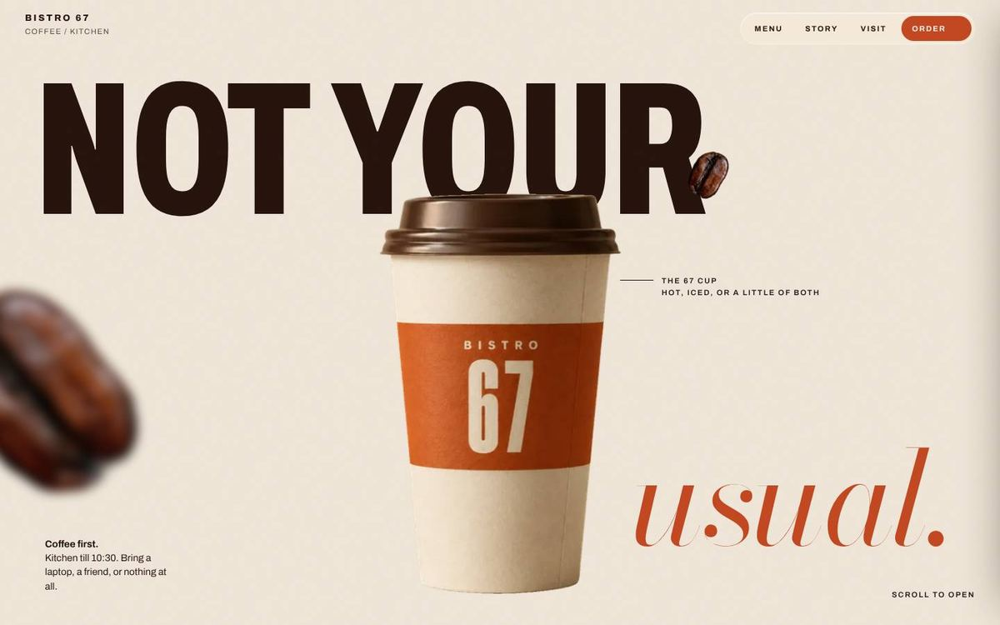
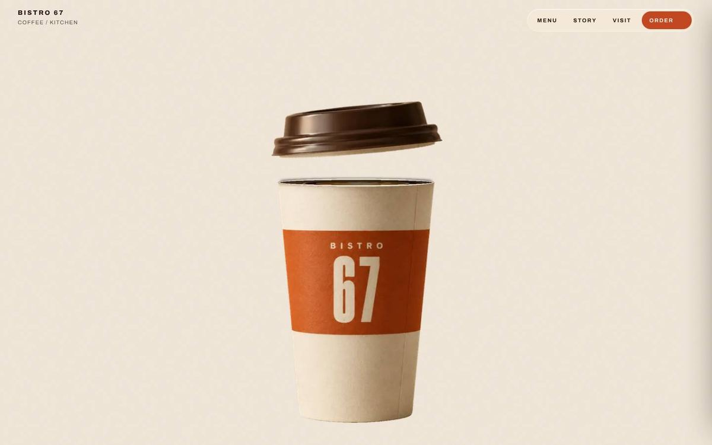
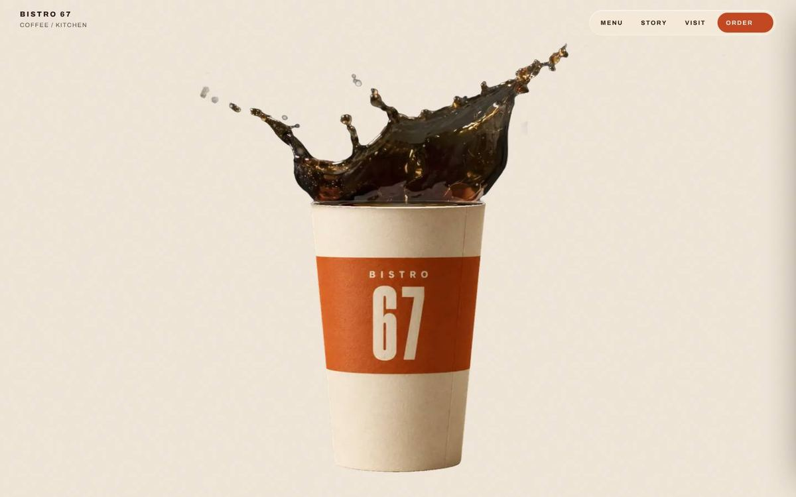
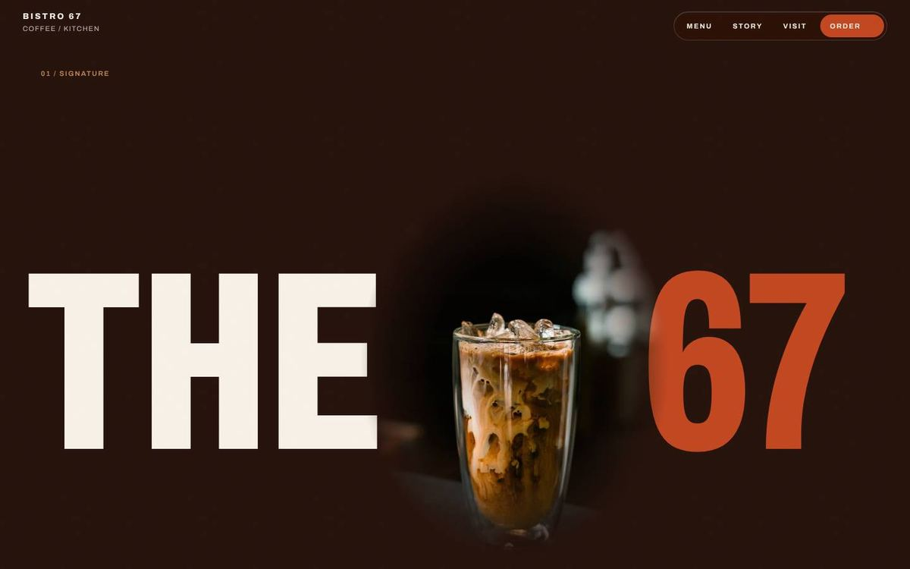
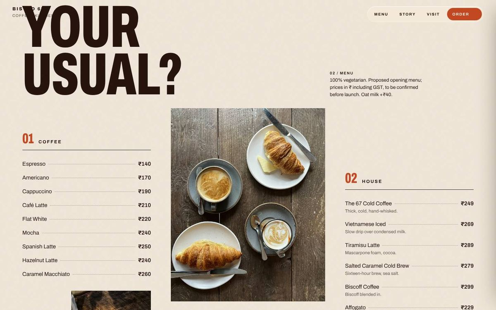
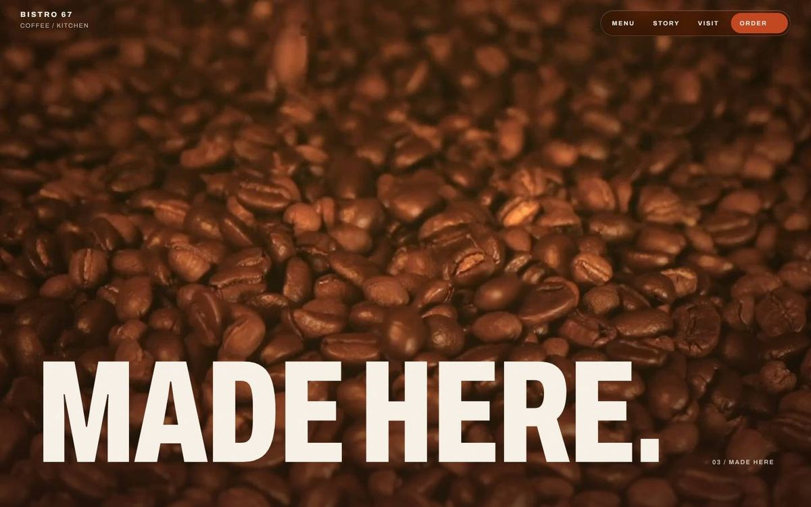
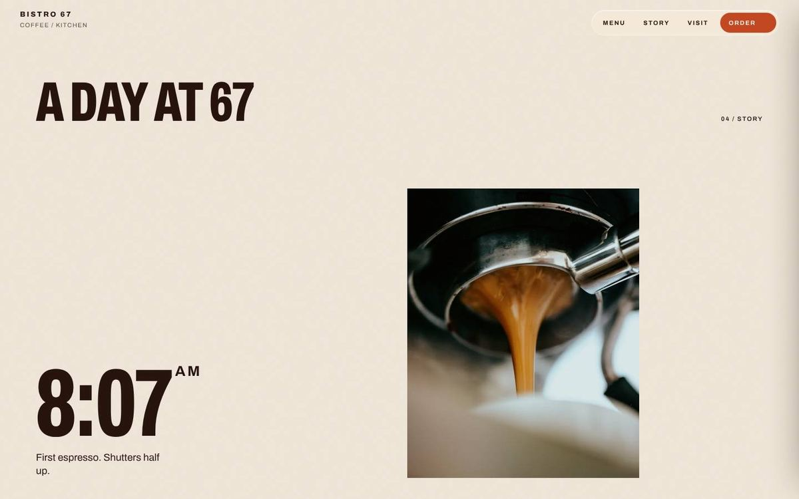
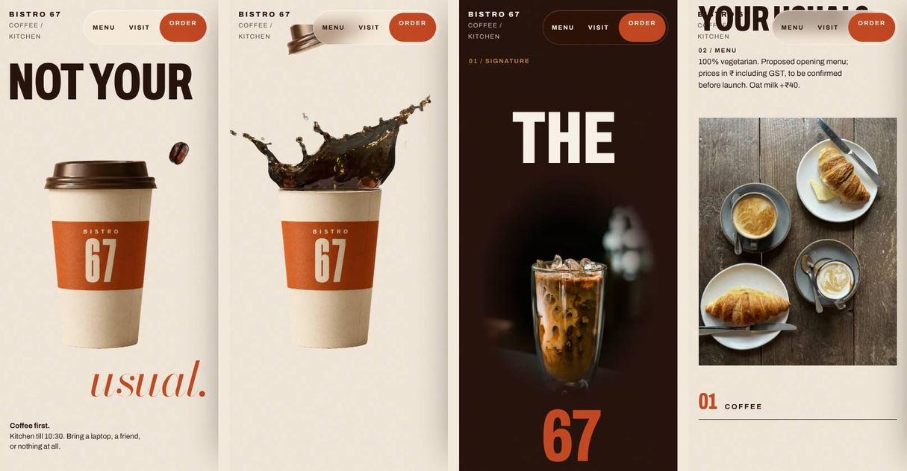

# Bistro 67 — Premium Café Website Concept

A cinematic, photographic website for a fictional café. Scroll and a branded takeaway cup lifts its lid, coffee bursts out, and the splash fills the screen to open the rest of the page.

**Live site:** https://icemantiffanyblu.github.io/bistro67-cafe-website/



> **Concept project.** Bistro 67 is not an operating café. The brand, menu, prices, opening hours and order list are demonstrations, and the site makes no claims about real customers. It was built as an AI-assisted design and development project, and serves as a portfolio example of the kind of website I build for independent cafés.

## What it shows

- **Cinematic scroll animation.** 96 transparent WebP frames drawn on a `<canvas>` and tied to scroll position with GSAP ScrollTrigger. Scroll down and the cup opens; scroll up and it closes again.
- **Café branding.** A recognisable "67" mark used across the cup, the signature drink and the footer, set in a condensed Archivo with a single Bodoni italic accent.
- **Food photography and film.** Real photographs throughout, plus a 25-second graded "Made here" film that plays only while it is on screen.
- **Editorial menu.** A printed-menu layout for Coffee and House drinks, with the full 44-item menu one click away.
- **Order-list preview.** Visitors build a list, see a running total and copy it as text. It is clearly labelled as a preview and sends nothing.
- **Responsive design.** Separate compositions for desktop and phone, not a shrunken desktop layout.
- **Accessibility.** Keyboard-operable order panel with a focus trap and Escape to close, alt text on every photo, visible focus states, and a reduced-motion mode that turns off the pinned scroll animation.

| Cup opening | Splash | Signature |
|---|---|---|
|  |  |  |

| Menu | Film | A day at 67 |
|---|---|---|
|  |  |  |



## Built with

- HTML, CSS and vanilla JavaScript. No framework and no build step.
- [GSAP 3.12](https://gsap.com/) with ScrollTrigger, for the pinned hero, scrubbed animation and section colour changes.
- [Lenis](https://github.com/darkroomengineering/lenis), for smooth scrolling.
- The Canvas 2D API, for drawing the hero frame sequence.
- Google Fonts: Archivo (variable width) and Bodoni Moda.
- Asset pipeline (not needed to run the site): Python with Pillow and rembg for cutouts and frame compositing, and ffmpeg for cutting and grading the film.

GSAP, ScrollTrigger and Lenis load from public CDNs (cdnjs and unpkg), pinned to exact versions.

## Project structure

```
index.html              Page markup
css/styles.css          All styles; brand colours and fonts are tokens at the top
js/config.js            Café details and menu (the file you edit per café)
js/main.js              Behaviour: hero sequence, scroll animation, menu, order list
assets/hero/seq/        cup_0001.webp … cup_0096.webp, the scroll animation
assets/hero/bean.webp   Coffee bean cutout used in the hero
assets/photo/           Photographs, each at 1600 px and 800 px wide
assets/film/            made-here.mp4 and its poster frame
assets/brand/           Favicon
docs/                   Screenshots, customisation guide, credits
```

## Run locally

The page must be served over HTTP; opening `index.html` directly from disk will not load the frames.

```
git clone https://github.com/icemantiffanyblu/bistro67-cafe-website.git
cd bistro67-cafe-website
python3 -m http.server 8000
```

Then open http://localhost:8000. Any static server works, for example `npx serve`.

## Deploy

**GitHub Pages (how this site is hosted).** In the repository, go to Settings → Pages, set Source to "Deploy from a branch", choose `main` and `/ (root)`, and save. The site appears at `https://<user>.github.io/bistro67-cafe-website/` within a minute or two. All asset paths are relative, so the site works under that subpath without changes.

**Other hosts.** Upload the repository folder as-is to Netlify, Vercel or Cloudflare Pages. There is no build command; the publish directory is the repository root.

## Reusing it for a real café

See [docs/CUSTOMIZING.md](docs/CUSTOMIZING.md). It covers where to change the name, logo, colours, menu, photography, hero animation, address and hours, and how to connect real ordering or reservations.

## Credits

Photography is from [Unsplash](https://unsplash.com/license) and film footage from [Pexels](https://www.pexels.com/license/), both free for commercial use. The cup is an AI-generated product image. Full per-file credits are in [docs/CREDITS.md](docs/CREDITS.md).

## Limitations

- **The hero splash is one real photograph**, scaled and timed across frames rather than a fluid simulation. It reads as liquid but does not evolve like filmed footage.
- **The cup is an AI-generated product image**, cut into separate lid and body layers. For a real café, replace it with a photographed or 3D-rendered cup of their own.
- **The film has no oven or caramel shot.** A slow golden coffee pour stands in for caramel, and dough and flour shots cover baking.
- **There is no backend.** The order list builds and copies text only, and there is no reservation system.
- **The hero frames total about 4 MB.** They load progressively, coarse frames first, so scrubbing works early, but the full sequence takes a moment on slow connections.

## Licence

Code in this repository is released under the MIT Licence (see `LICENSE`). Photographs and film footage remain under their original Unsplash and Pexels licences, and the Bistro 67 name and imagery are part of a fictional concept.
